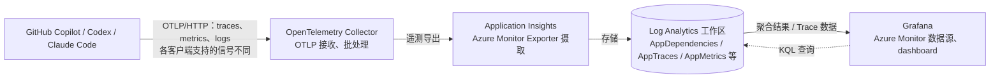

# AI 编码代理 Grafana 仪表盘

本仓库管理 GitHub Copilot、Codex 和 Claude Code 的 Azure Managed Grafana
dashboard JSON 定义，包含资源筛选、用量统计、模型与工具性能、错误分析及链路下钻。

**仓库只保存可复用定义与通用操作说明。真实订阅、资源组、实例、数据源标识和部署地址仅保留在 Multica 项目描述中。**
不要提交凭据、连接串、遥测记录、Prompt 或响应正文。本文示例中的占位符必须在仓库之外按目标环境填写。

## 仓库内容

| 文件 | Grafana UID | 用途 |
|---|---|---|
| `dashboards/github-copilot.json` | `GitHubCopilot` | Copilot 使用情况、Token、模型性能、工具与 Trace |
| `dashboards/codex.json` | `Codex` | Codex 会话、执行轮次、Token、工具可靠性与耗时 |
| `dashboards/claude-code.json` | `ClaudeCode` | Claude Code 用量、费用、Prompt 事件、工具与 API 错误 |
| `docs/data-flow.excalidraw` | 不适用 | 可编辑的数据流图源文件 |

dashboard 文件只包含模型，不包含 Grafana API 的 `{dashboard, meta}` 包装。
实例内数字 `id`、`version` 分别重置为 `null`、`0`；稳定 UID、KQL、筛选变量和布局保留。
数据源、订阅、资源组及 Application Insights 默认选择为空，导入后需要选择。

## 数据流



Grafana 不接收代理的 OTLP 数据，也不会通过刷新面板重新摄取数据。
Application Insights 的 `traces` / 工作区的 `AppTraces` 是**日志表**，
不等同于分布式 Trace；后者主要由 `dependencies`、`requests` 及其关联标识组成。
Claude Code 的日志和指标可供仪表盘使用，但不能据此断言客户端已启用分布式 tracing。

可编辑图包含 5 个组件框、5 个组件文字、4 个箭头、3 个说明文字，共 17 个元素。
将 [`docs/data-flow.excalidraw`](docs/data-flow.excalidraw) 下载后拖入
[Excalidraw](https://excalidraw.com)，或用 VS Code Excalidraw 扩展打开。
不要将带有真实环境信息或遥测正文的图上传到外部编辑服务。

## 部署步骤

以下为通用部署流程，不是对线上环境的自动部署授权。使用分支和 PR 管理定义变更；
部署前检查最新线上模型，避免覆盖他人的修改。

### 1. 准备 Azure 资源与权限

1. 创建或选择 Log Analytics 工作区，并创建关联该工作区的 Application Insights。
2. 创建或选择 Grafana 11.6 及以上版本；准备 Azure Monitor 数据源。
3. 为 Grafana 使用的身份授予所需读取权限，例如目标监控资源上的
   Monitoring Reader；通过工作区查询时还应检查工作区读取权限。
   登录 Grafana 的用户也需要相应 Grafana 角色。
4. 准备 Docker 与经过验证的 OpenTelemetry Collector contrib 镜像版本。
   此发行版包含 `azuremonitor` exporter。生产部署应固定版本，不使用浮动 `latest`。

真实环境值从 Multica 项目描述取得，在终端设置，不写入仓库：

```bash
export AZURE_SUBSCRIPTION_ID='<subscription-id>'
export AZURE_RESOURCE_GROUP='<resource-group>'
export GRAFANA_NAME='<grafana-name>'
export GRAFANA_FOLDER='<folder-name>'
export APP_INSIGHTS_NAME='<application-insights-name>'
az account set --subscription "$AZURE_SUBSCRIPTION_ID"
```

### 2. 部署 Collector

在**仓库外的受限目录**保存以下 `collector.yaml` 示例：

```yaml
receivers:
  otlp:
    protocols:
      http:
        endpoint: 0.0.0.0:4318

processors:
  memory_limiter:
    check_interval: 1s
    limit_mib: 512
    spike_limit_mib: 128
  batch: {}

exporters:
  azuremonitor:
    connection_string: ${env:APPLICATIONINSIGHTS_CONNECTION_STRING}

service:
  pipelines:
    traces:
      receivers: [otlp]
      processors: [memory_limiter, batch]
      exporters: [azuremonitor]
    metrics:
      receivers: [otlp]
      processors: [memory_limiter, batch]
      exporters: [azuremonitor]
    logs:
      receivers: [otlp]
      processors: [memory_limiter, batch]
      exporters: [azuremonitor]
```

通过密钥管理系统或受限环境文件提供 `APPLICATIONINSIGHTS_CONNECTION_STRING`。
例如在受限目录内创建 `collector.env`，文件权限设为 `600`；不要输出连接串到日志，
也不要把文件、命令执行记录或密钥复制进仓库。

```bash
export COLLECTOR_CONFIG_DIR='<absolute-path-outside-repository>'
export COLLECTOR_VERSION='<tested-contrib-version>'
: "${COLLECTOR_CONFIG_DIR:?}" "${COLLECTOR_VERSION:?}"
docker run -d --name otel-collector --restart unless-stopped \
  --env-file "$COLLECTOR_CONFIG_DIR/collector.env" \
  -p 127.0.0.1:4318:4318 \
  -v "$COLLECTOR_CONFIG_DIR/collector.yaml:/etc/otelcol-contrib/config.yaml:ro" \
  "otel/opentelemetry-collector-contrib:$COLLECTOR_VERSION"
docker logs --tail 50 otel-collector
```

示例仅将主机端口绑定到回环地址。其他机器不能直接连接这个地址；
多机器共享 Collector 时应单独配置受控网络、TLS、认证与防火墙，不直接公开裸 OTLP 接口。
核对容器运行状态和 exporter 错误；仅端口开放不代表 Azure 已收到数据。

### 3. 配置编码代理

配置应合并进已有用户设置，不覆盖已有内容；修改后重启相应客户端。
企业托管设置可能覆盖用户设置或环境变量，应以实际客户端版本和有效策略为准。

**GitHub Copilot（VS Code）**：在用户 `settings.json` 中加入：

```json
{
  "github.copilot.chat.otel.enabled": true,
  "github.copilot.chat.otel.exporterType": "otlp-http",
  "github.copilot.chat.otel.otlpEndpoint": "http://localhost:4318",
  "github.copilot.chat.otel.captureContent": false
}
```

**Copilot CLI**：支持这些环境变量的版本可在启动前设置：

```bash
export COPILOT_OTEL_ENABLED=true
export OTEL_EXPORTER_OTLP_ENDPOINT=http://localhost:4318
export OTEL_EXPORTER_OTLP_PROTOCOL=http/protobuf
copilot
```

不要为排查或部署默认开启内容采集；CLI 企业策略和 SDK 配置见文末官方参考。

**Claude Code**：在用户 `settings.json` 的 `env` 中合并：

```json
{
  "env": {
    "CLAUDE_CODE_ENABLE_TELEMETRY": "1",
    "OTEL_METRICS_EXPORTER": "otlp",
    "OTEL_LOGS_EXPORTER": "otlp",
    "OTEL_EXPORTER_OTLP_PROTOCOL": "http/protobuf",
    "OTEL_EXPORTER_OTLP_ENDPOINT": "http://localhost:4318",
    "OTEL_LOG_USER_PROMPTS": "0",
    "OTEL_LOG_ASSISTANT_RESPONSES": "0"
  }
}
```

正确名称是复数 `OTEL_LOG_USER_PROMPTS`。默认关闭正文采集时，Prompt 内容面板可能显示
脱敏标记；这不代表费用、Token 或 API 事件没有上报。确需采集正文时先取得授权，
评估敏感信息、访问权限、保留期与数据量；历史脱敏内容不能恢复。

**Codex**：在用户级 `~/.codex/config.toml` 中合并以下配置。
不要仅写到项目级配置；避免与已有 `[otel]` 重复定义：

```toml
[otel]
log_user_prompt = false
exporter = { otlp-http = { endpoint = "http://localhost:4318/v1/logs", protocol = "binary" } }
trace_exporter = { otlp-http = { endpoint = "http://localhost:4318/v1/traces", protocol = "binary" } }
metrics_exporter = { otlp-http = { endpoint = "http://localhost:4318/v1/metrics", protocol = "binary" } }
```

指标 exporter 等能力随版本变化，部署时核对客户端配置参考与启动错误。
启动进程前，可用 `OTEL_RESOURCE_ATTRIBUTES` 注入分类资源属性：

```bash
export OTEL_RESOURCE_ATTRIBUTES='work.project=<project-label>,deployment.environment.name=<environment-label>,host.name=<machine-label>'
```

这是属性示例，不保证所有客户端和所有信号都保留每个属性。应在实际入库数据中验证；
不要覆盖客户端用于 dashboard 来源识别的 `service.name`。

### 4. 验证摄取

运行一段真实代理会话，并等待客户端批量导出。在 **Application Insights → Logs** 中执行：

```kusto
union withsource=TableName dependencies, requests, traces, customMetrics
| where timestamp >= ago(1h)
| summarize Records=count(), LastEvent=max(timestamp) by TableName, cloud_RoleName
| order by LastEvent desc
```

这只返回数量和时间，不返回正文。若无数据，检查有效客户端配置、进程是否重启、
Collector 日志、网络及 exporter 认证；不要仅根据 dashboard 空白判断客户端故障。

### 5. 导入 dashboard

先在 Grafana 创建或选择文件夹；确认 Azure Monitor 数据源能够读取目标资源。
也可通过 UI 的 Import 上传 JSON。Azure CLI 示例：

```bash
: "${AZURE_SUBSCRIPTION_ID:?}" "${AZURE_RESOURCE_GROUP:?}" \
  "${GRAFANA_NAME:?}" "${GRAFANA_FOLDER:?}"
for definition in dashboards/github-copilot.json dashboards/codex.json dashboards/claude-code.json; do
  az grafana dashboard import \
    --subscription "$AZURE_SUBSCRIPTION_ID" \
    --resource-group "$AZURE_RESOURCE_GROUP" \
    --name "$GRAFANA_NAME" \
    --definition "$definition" \
    --folder "$GRAFANA_FOLDER"
done
```

`--definition` 使用普通路径，不加 `@`。若同 UID 已存在，先导出、比较并确认覆盖，
再在经授权的更新操作中使用 `--overwrite true`；上述首次导入示例不主动覆盖。
CLI 需要可用的 `amg` 扩展及对应写权限。

导入后依次选择 **Data Source、Subscription、Resource Group、Application Insights**，
再选择 Source（Copilot）及项目等筛选器，保存选择在目标 Grafana 实例中，不提交回仓库。
核对数小时及多天范围，测试 All、具体项目与 `(not set)`；最后重新导出确认保存结果。

## Azure Application Insights 成本计算

以下计算针对 **workspace-based Application Insights + Analytics 表 + 按量计费**。
真实单价、合同优惠、币种和账单信息不写入仓库；通过目标区域定价页及 Cost Management 核对。

### 计费构成

| 项目 | 计算原则 |
|---|---|
| 数据摄取 | 按可计费记录大小，1 GB = `10^9` 字节，不按 Token 数、span 条数或网络包大小直接计费 |
| 数据保留 | Application Insights 数据包含 90 天保留；超出免费期按存储量和保留天数收费 |
| 普通查询 | Analytics 保留期内的普通查询包含在价格中；Grafana 刷新不重复摄取 |
| 其他费用 | 告警、数据导出、搜索任务、恢复、复制及 Sentinel 等服务可能另收费 |

按量 Analytics 摄取当前有**每个计费账户每月前 5 GB 免费**的规则；
不是每个资源或工作区单独获得 5 GB。使用前核对当期政策和该账户其他资源的额度消耗。
Basic / Auxiliary 表的查询收费与功能限制不同，不能直接套用本节或任意切换表计划。
Managed Grafana、Collector 所在计算资源、网络与编码代理模型费用不包含在日志摄取费用中。

### 用 KQL 测量可计费大小

在 **Log Analytics 工作区 → Logs** 使用工作区表名，而不是 Application Insights 的别名表。
将 `targetResource` 替换为目标 Application Insights ARM ID（只在查询界面填写）。
下例使用最近 7 个**完整 UTC 日**的摄取时间，排除当前不完整日；用 `_BilledSize`
和 `_IsBillable` 统计，不获取遥测正文：

```kusto
let targetResource = "/subscriptions/<subscription-id>/resourceGroups/<resource-group>/providers/microsoft.insights/components/<application-insights-name>";
let endTime = startofday(now());
let startTime = endTime - 7d;
union withsource=TableName
    AppDependencies, AppRequests, AppTraces, AppMetrics, AppEvents,
    AppExceptions, AppPageViews, AppPerformanceCounters,
    AppAvailabilityResults, AppBrowserTimings
| where _ResourceId =~ targetResource
| extend Ingested = ingestion_time()
| where Ingested >= startTime and Ingested < endTime
| summarize Records=count(),
    BillableBytes=sumif(_BilledSize, _IsBillable =~ "true")
    by Day=bin(Ingested, 1d), TableName, AppRoleName
| extend BillableGB = BillableBytes / 1e9
| order by Day asc
```

把查询界面的时间范围设为覆盖所查摄取期间及可能延迟的事件时间，必要时选择覆盖全部
保留数据的范围；界面按 `TimeGenerated` 预过滤可能漏掉延迟摄取的旧事件。
`ingestion_time()` 为空的记录不能用于此分组，应检查摄取时间策略。
新增遥测表（例如 `AppGenAIContent`）需按实际使用情况加入，不能将上面的列表视为永远完整。
若只分析某个代理，可追加 `AppRoleName` 条件；若评估整个工作区，移除资源条件并计入其他表。
用完整观察天数作除数，包括确认无摄取的零用量日；不要只按有数据的分组数量求日均。
刚接入的天数、停收、采样和版本升级会使样本失真，建议观察 7～30 天。

### 月度估算公式

设：

- `B`：观察期内可计费字节总量；`D`：完整观察天数。
- `M`：目标月份天数；`P`：所在区域及合同适用的摄取单价（货币/GB）。
- `F`：可分配给本范围的剩余免费额度（GB），未知时按 `0` 作保守预算。

```text
日均摄取量 = B / 10^9 / D
预计月摄取量 V = 日均摄取量 × M
预计摄取费用 = max(V - F, 0) × P
```

**纯假设示例，不代表当前部署或区域价格**：观察 7 天共 0.35 GB，按 30 天计算，
月量为 1.5 GB；假设单价为 3 货币单位/GB，免费额度已用完，则费用为 4.5 货币单位/月。
若还有 1 GB 可分配免费额度，则为 1.5 货币单位/月。

若持续日均摄取 `d GB`、免费保留期 `R0` 天、实际保留 `R` 天，稳定状态下：

```text
超期存储量约为 d × max(R - R0, 0) GB
月保留费用约为超期存储量 × 对应保留单价（货币/GB/月）
总费用约为摄取费用 + 超期保留费用 + 已启用的其他收费功能
```

这里只是均匀摄取的预算近似。交互保留与长期保留单价应分别计算，
实际按每日存储量计费；达到稳定状态前、数据量波动或保留策略变化时不能机械套用。
承诺层按每日购买容量结算，也不能用上述简单按量公式代替。

### 控费与账单核对

先按表、来源统计数据量，再评估高频指标、重复事件及正文长度。
优先使用预算与用量告警；每日硬限额可能停收数据，且不保证精确费用上限。
不要在未验证统计影响时对 Trace 采样；采样会影响调用计数、错误率及完整链路。
保留期降到免费期以下通常不节省摄取费用。

workspace-based Application Insights 的摄取与保留费用归属关联工作区。
在 Cost Management 按工作区资源、服务和计量项核对实际费用，考虑数据延迟、
免费额度、合同折扣、税费及叠加服务；KQL 推算不是发票。

## 必须保留的行为

- 时间趋势查询使用 `bin(timestamp, $__interval)`，没有自动补零。
- 18 个时间柱状图使用 `maxDataPoints = 60`、`barWidthFactor = 1`。
  `60` 是分辨率设置，不保证恰好返回 60 个非空桶；无数据时段仍可能有空档。
- Copilot 的 **Input vs Output Tokens Over Time** 曲线图使用自动点数；
  Codex 的 **Completed-turn duration over time** 曲线图使用 48 点。
  不要将柱状图设置批量施加到曲线图。
- 三个 dashboard 支持 `work.project`；Copilot 额外支持 `host.name`、
  `deployment.environment.name`。缺失属性显示 `(not set)`，不推断或回填。
- 模型请求与 Agent 汇总用量不是可直接相加的独立消费，避免父子调用重复累计。
  编码代理用量、模型账单和 Application Insights 摄取费用是不同成本口径。
- 不因修改 dashboard 自动开启 Prompt、响应或工具参数内容采集。
- 环境信息只存 Multica 项目描述；仓库定义变更不会自动部署到 Grafana。

## 官方参考与来源

- [Microsoft Learn：监控 AI 编码代理](https://learn.microsoft.com/en-us/azure/managed-grafana/grafana-opentelemetry-app-insights)
- [VS Code：Copilot 代理监控](https://code.visualstudio.com/docs/copilot/guides/monitoring-agents)
- [GitHub：企业 OpenTelemetry](https://docs.github.com/en/copilot/concepts/enterprise/opentelemetry)
- [Copilot SDK / CLI 遥测配置](https://github.com/github/copilot-sdk/blob/main/docs/observability/opentelemetry.md)
- [Claude Code：监控用量](https://code.claude.com/docs/en/monitoring-usage)
- [Codex：配置参考](https://developers.openai.com/codex/config-reference/)
- [Azure Monitor Exporter](https://github.com/open-telemetry/opentelemetry-collector-contrib/tree/main/exporter/azuremonitorexporter)
- [Azure Monitor 定价](https://azure.microsoft.com/en-us/pricing/details/monitor/)
- [日志计费规则](https://learn.microsoft.com/en-us/azure/azure-monitor/logs/cost-logs)
- [保留策略](https://learn.microsoft.com/en-us/azure/azure-monitor/logs/data-retention-configure)

## 上游许可与归属

`dashboards/github-copilot.json`、`dashboards/codex.json` 和
`dashboards/claude-code.json` 改编自
[1w2w3y/grafana-dashboards](https://github.com/1w2w3y/grafana-dashboards)
中的同名仪表盘。上游作者的版权声明为 Copyright (c) 2020 Wuyi Weng；
上游采用 MIT License，完整版权与许可声明见本仓库的 [LICENSE](LICENSE)。
本仓库维护上述仪表盘的后续修改及新增文档，不将这些修改归于上游作者。
